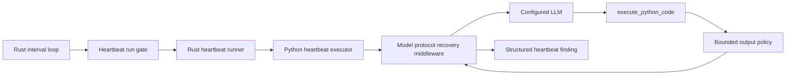

# TerminAI Model-Agnostic Heartbeat Reliability

**Date:** 2026-07-29

**Status:** Implemented and live-canary validated on 2026-07-30

**Source diagnosis:** `/Users/shaunwhi/Documents/Shauns-Remote-Vault/wiki/questions/why-terminai-heartbeats-fail-with-tuned-gpt-oss-120b.md`

**Scope:** The four diagnosed heartbeat fixes, without model-specific control flow

## Goal

Make unattended TerminAI heartbeats reliable with any supported LangChain chat
model or OpenAI-compatible endpoint.

The work is complete when:

1. TerminAI-owned tool output is compacted and hard-bounded before DeepAgents
   can evict it to `/large_tool_results`.
2. A recoverable model-response protocol/parser failure gets exactly one
   same-turn retry through a non-streaming fallback, while permanent failures
   fail immediately and visibly.
3. `interval_minutes` means a real elapsed interval, including values such as
   39 and 90, and `next_run_at` always describes the next scheduled run.
4. Heartbeat concurrency is controlled locally and independently of the model
   server. The current DGX Spark `max-num-seqs=1` stability setting remains
   untouched.

No production branch may select behavior by model name, provider marketing
name, or endpoint identity.

## Current Ground Truth

- The installed runtime is DeepAgents 0.6.8. `create_deep_agent()` defaults to
  an ephemeral `StateBackend`.
- DeepAgents' `FilesystemMiddleware` evicts a tool result above approximately
  20,000 tokens to its virtual `/large_tool_results/<tool-call-id>` namespace
  and tells the model to recover it with the built-in `read_file` tool.
- TerminAI's `execute_python_code` tool currently returns captured stdout
  without a bound. Its Python sandbox is separate from DeepAgents'
  `StateBackend`, so `pathlib` cannot open the virtual result path.
- Live logs show this exact sequence: a large Meraki result was evicted, the
  model tried to open `/large_tool_results/...` inside
  `execute_python_code`, `FileNotFoundError` repeated, and the graph reached
  the 60-step safety limit.
- Other live failures include response-protocol errors such as
  `unexpected tokens remaining in message header` and `Unknown role: final`.
  `run_and_stream()` currently catches these and emits a generic error event;
  no bounded recovery is attempted.
- `interval_to_cron()` changes interval semantics:
  - 39 minutes becomes clock-aligned runs at minute `0` and `39`, producing
    alternating 39- and 21-minute gaps.
  - 90 minutes is integer-divided to one hour.
  - `next_run_at` is written only during registration and becomes stale after
    the first run.
- The Rust runner starts the Python timeout only after a check begins. This
  makes it safe to place a local queue outside `run_heartbeat()` without
  consuming the 540/600/720-second execution timeout budgets while waiting.

## Design Invariants

- Bound data at the producer seam. Do not depend on an LLM following a prompt
  to avoid oversized output.
- Keep DeepAgents' virtual filesystem virtual. Do not expose a shared host
  directory merely to make `/large_tool_results` visible to Python.
- Preserve exact results when they are already below budget.
- For oversized results, preserve deterministic counts, shape, samples, and a
  sandbox-local retrieval path; never silently discard data with no recovery
  route.
- Retry only a failed model call. Never replay a completed tool call or an
  entire heartbeat check.
- Retry at most once and only for response-protocol parsing failures.
- Do not retry authentication, authorization, invalid configuration, context
  overflow, tool execution, timeout, or graph step-limit failures.
- Scheduled and manual runs for the same heartbeat never overlap. All
  heartbeat runs share a local concurrency gate whose default is one.
- A delayed or long run skips missed ticks instead of creating a catch-up burst.
- Keep the existing SQLite schema, Tauri command names, frontend types, finding
  schema, and app-data directory.
- Do not raise the recursion limit, context window, or timeout ceilings as part
  of this fix.

## Responsibility Map



The Rust side owns time and local concurrency. The Python heartbeat layer owns
execution policy and findings. The shared DeepAgents tool seam owns output
containment. The model server remains an external dependency, not a source of
application scheduling semantics.

## Fix 1: Bound and Recover Tool Output

### Files

- Add
  `sidecar/src/ccie_sidecar/agents/tool_output.py`.
- Modify
  `sidecar/src/ccie_sidecar/agents/code_exec.py`.
- Modify
  `sidecar/src/ccie_sidecar/agents/deepagents_tools.py`.
- Modify
  `sidecar/src/ccie_sidecar/agents/architect_subagents.py`.
- Modify the universal heartbeat guidance in
  `sidecar/src/ccie_sidecar/agents/heartbeat_executor.py`.
- Add
  `sidecar/tests/agents/test_tool_output.py`.
- Add
  `sidecar/tests/agents/test_architect_tool_output.py`.
- Extend
  `sidecar/tests/agents/test_code_exec.py`.
- Extend
  `sidecar/tests/test_heartbeat_execute.py`.

### Implementation

1. Add a provider-neutral `ToolOutputPolicy` with these defaults:
   - maximum returned text: 48,000 characters;
   - maximum retained raw stdout: 2 MiB;
   - retain only the latest raw result per code-exec sandbox.
2. Add a sandbox-local `tool_output` helper before the first code execution.
   It owns the latest captured stdout and exposes bounded operations:
   - `tool_output.stats()`;
   - `tool_output.head(lines=...)`;
   - `tool_output.tail(lines=...)`;
   - `tool_output.grep(pattern, limit=...)`;
   - `tool_output.json()` when the retained payload is valid JSON.
3. After `_execute_code_with_timeout()` returns and before
   `execute_python_code()` returns to LangChain:
   - store the raw stdout in `tool_output`;
   - return it unchanged when it is below the budget;
   - otherwise try JSON, NDJSON, or delimited-table parsing while the complete
     retained result is at most 2 MiB;
   - for flat records, emit record count, columns, and a compact deterministic
     sample using `ccie_sidecar.serialize.graph_compact` directly, independent
     of the optional context-graph feature flag;
   - for other text, emit character/line counts plus bounded head and tail
     samples;
   - append exact instructions for querying the retained result through
     `tool_output`.
4. Apply the same bound to error/traceback text so failures cannot trigger
   DeepAgents eviction.
5. Add universal guidance to the tool description and heartbeat prompt:
   - a path under `/large_tool_results` belongs to DeepAgents' virtual backend;
   - use the built-in `read_file(file_path=..., offset=..., limit=...)` for such
     a path;
   - never use `pathlib`, `open()`, or `execute_python_code` on that path;
   - use `tool_output` for TerminAI code-exec stdout that was summarized.
6. Keep the built-in `read_file` tool available to heartbeat agents. Do not add
   a host `FilesystemBackend`, shared temp directory, or new filesystem
   permission.
7. Coordinate code execution at the process-global seam because Python's
   `redirect_stdout` and `os.environ` are process-global:
   - serialize executions across all sandboxes without charging queue time to
     the code watchdog;
   - retain ownership until a timed-out worker really exits and restores the
     environment;
   - quarantine queued and new executions with a bounded, explicit error while
     that overrun is still alive;
   - clear quarantine only when that exact worker has restored process state.

### Accepted Safety Deviation

Outputs above the 2 MiB raw-retention ceiling are not reparsed as complete
JSON/NDJSON/CSV. They receive exact byte/character/line statistics plus bounded
head/tail retention. This deliberately trades complete structural recovery for
bounded CPU and memory use on adversarial tool output. Results at or below the
ceiling retain the planned structured counts, schema, samples, and query
operations.

### Tests

- A 47,999-character result is byte-for-byte unchanged.
- A result well above DeepAgents' current approximately 80,000-character
  eviction boundary returns at most 48,000 characters.
- The bounded result contains original size, record/line counts, and an explicit
  retrieval instruction.
- A sentinel placed in the middle of a 100,000-character result is retrievable
  through `tool_output.grep()` even though it is absent from the returned
  preview.
- JSON arrays, NDJSON, plain text, one very long line, Unicode, and malformed
  JSON are deterministic and never raise.
- Raw retention stops at 2 MiB and reports that retention itself was clipped.
- Neither the returned result nor the generated recovery instruction invents a
  `/large_tool_results` path.
- A focused DeepAgents contract test proves the returned tool message stays
  inline and does not become a virtual-file pointer.

## Fix 2: One Bounded Model-Protocol Retry

### Files

- Add
  `sidecar/src/ccie_sidecar/agents/model_recovery.py`.
- Modify
  `sidecar/src/ccie_sidecar/agents/deepagents_runtime.py`.
- Modify
  `sidecar/src/ccie_sidecar/agents/deepagents_stream.py`.
- Modify
  `sidecar/src/ccie_sidecar/agents/heartbeat_executor.py`.
- Add
  `sidecar/tests/agents/test_model_recovery.py`.
- Extend
  `sidecar/tests/agents/test_deepagents_stream.py` and
  `sidecar/tests/test_heartbeat_execute.py`.

### Implementation

1. Introduce a reusable `AgentExecutionPolicy`. The heartbeat caller enables:
   - one response-protocol retry;
   - non-streaming fallback on that retry;
   - structured run-outcome collection.
   Existing interactive callers keep their current behavior unless they
   explicitly opt into the policy.
2. Add `ModelProtocolRecoveryMiddleware` around the model-call seam, not around
   the whole graph.
3. Classify the complete exception chain by protocol symptoms and exception
   category. The classifier must not inspect a model name or provider ID.
   Recoverable examples include malformed response headers/roles and stream
   decoding failures. Explicitly exclude:
   - 401/403 and missing credentials;
   - invalid endpoint/model configuration;
   - rate limits already handled by provider clients;
   - context-window overflow;
   - request and heartbeat timeouts;
   - tool exceptions;
   - `GraphRecursionError`.
4. On the first recoverable failure:
   - keep the same `ModelRequest`, messages, tool schemas, and graph state;
   - clone the current LangChain `BaseChatModel` with
     `disable_streaming=True`;
   - invoke the model handler one more time;
   - do not rebuild or replay the graph.
5. If the fallback also fails, re-raise a structured recovery error containing
   the final category and attempt count. Do not make a third call.
6. Extend `run_and_stream()`'s existing return dictionary with:
   - `final_emitted`;
   - `steps`;
   - `error_kind`;
   - `error_type`;
   - `recovery_attempts`;
   - `fallback_mode`.
   Keep the NDJSON event contract unchanged.
7. Return that outcome from `deepagents_react_code_loop()`. The existing server
   caller may ignore it; the heartbeat executor consumes it.
8. Make heartbeat fallback behavior explicit:
   - final text present: parse normally;
   - no final text but successful bounded tool results: keep the current
     degraded raw-data finding and tag its metadata as `degraded=true`;
   - runtime error: emit one error finding with the structured category and
     recovery count;
   - no final, no tool result, and no runtime error: classify as
     `empty_final`, with no unbounded loop.
9. Keep the existing step and timeout ceilings. Replace model-specific timeout
   comments with the general ordering invariant:
   Python agent timeout < Rust check timeout < bridge idle timeout.

### Tests

- A fake chat model that fails its streamed call with a recoverable header error
  and succeeds non-streaming is called exactly twice.
- The second call receives the identical messages and tools and has
  `disable_streaming=True`.
- Previously completed tool messages remain in state and are not re-executed.
- A second protocol failure produces one structured error finding and no third
  attempt.
- Auth, configuration, context overflow, timeout, tool, and graph recursion
  failures make zero recovery attempts.
- Recovery behavior is identical for fake OpenAI-compatible, Anthropic,
  Google, and Ollama `BaseChatModel` implementations.
- A successful run with no final but with tool data returns the degraded
  fallback finding rather than a false clean result.

### Optional Endpoint-Runtime Remediation

Treat a vLLM image/parser update as a separate operational lane, not part of
TerminAI's correctness contract:

1. Record the live image digest, launch arguments, model identity, health
   result, and a real-generation canary.
2. Copy the working recipe and pin a candidate image/parser version in the
   copy. Never overwrite the known-good recipe.
3. Start the candidate on an alternate port or isolated maintenance window and
   run the same OpenAI-compatible response-contract probes, including tool
   calls, streamed final text, and malformed-header regression cases.
4. Promote only if the candidate passes those probes plus a bounded soak with
   no CUDA/Xid, health, throughput, or response-format regression.
5. Roll back by stopping the candidate and relaunching the untouched
   known-good recipe.

TerminAI's retry and outcome code must behave correctly before, during, and
after such an update. It must not inspect the vLLM version or require the update
to pass.

## Fix 3: Replace Cron Conversion with True Intervals

### Files

- Modify
  `src-tauri/src/heartbeat/scheduler.rs`.
- Replace the cron-conversion tests in
  `src-tauri/src/heartbeat/scheduler_tests.rs`.
- Modify
  `src-tauri/src/heartbeat/commands.rs`.
- Extend
  `src-tauri/src/heartbeat/repo_tests.rs` only if repository-level
  `next_run_at` coverage is clearer there.

No migration, frontend, or heartbeat type change is required.

### Implementation

1. Preserve the public `HeartbeatScheduler` API, but replace its heartbeat-only
   `tokio_cron_scheduler::JobScheduler` internals with one Tokio task per
   enabled heartbeat.
2. Store each task as a cancellation token plus join handle, keyed by heartbeat
   ID. `pause`, update, delete, re-register, and shutdown cancel without holding
   a synchronous mutex across `.await`.
3. Use the persisted `next_run_at` as the phase anchor:
   - if it is in the future, retain it across app restart;
   - if it is missing, use `now + interval`;
   - if it is stale, advance by whole intervals until it is in the future;
   - never replay missed runs at startup.
4. Before sleeping, persist the exact due timestamp.
5. At a scheduled tick, advance and persist the following future timestamp
   before emitting completion. If the current run or queue wait passed one or
   more ticks, advance over them rather than burst.
6. A scheduled task awaits its own run. The common run coordinator described
   in Fix 4 also serializes manual and scheduled runs for the same heartbeat.
7. Manual `trigger_now` uses the common run path but does not move the periodic
   phase anchor.
8. `pause` clears `next_run_at`. `resume` computes and persists a new future
   timestamp. Shutdown preserves the future timestamp for restart.
9. After `heartbeat_update()` re-registers an enabled heartbeat, re-fetch and
   return the row so the command response contains the new `next_run_at`.
10. Keep startup orphan-execution reaping and completion/critical event
    behavior unchanged.

### Pure Scheduling Rule

For interval `P`, prior due time `D`, and current time `N`, calculate the next
future due time as:

```text
candidate = D + P
while candidate <= N:
    candidate += P
```

Production code should use checked integer arithmetic and a closed-form skip
count rather than an unbounded loop.

### Tests

- 39 minutes always produces a 2,340-second delta, including across an hour
  boundary.
- 90 minutes always produces a 5,400-second delta.
- One day and multi-day intervals retain exact elapsed semantics.
- A stale due time advances to the first future phase without catch-up runs.
- A future persisted due time survives scheduler restart.
- `next_run_at` advances after every tick and is future-dated when the
  completion event is emitted.
- A long run skips missed ticks and never starts a same-heartbeat overlap.
- Pause cancels the future run and clears `next_run_at`; resume restores one.
- Updating an interval replaces the old task and returns the refreshed row.
- Manual trigger leaves the scheduled phase unchanged.
- Shutdown/restart does not create duplicate tasks.

## Fix 4: Decouple Heartbeats from Model-Server Concurrency

### Files

- Implement the run gate inside
  `src-tauri/src/heartbeat/scheduler.rs`.
- Extend
  `src-tauri/src/heartbeat/scheduler_tests.rs`.
- Do not modify `run.sh`, provider settings, the DGX Spark recipe, vLLM launch
  arguments, or model-selection code.

### Implementation

1. Add a scheduler-owned run coordinator around the common scheduled/manual
   heartbeat path. It contains:
   - one keyed single-permit semaphore per heartbeat ID, preventing a manual
     trigger from overlapping that heartbeat's scheduled run;
   - one global Tokio semaphore controlling concurrency across different
     heartbeat IDs.
2. Acquire the keyed permit first and the global permit second on every run.
   Keep both permits until `runner::run_heartbeat()` and completion-event
   emission finish.
3. Default `CCIE_HEARTBEAT_MAX_CONCURRENCY` to `1`. Parse and clamp an optional
   operator override to a small positive range, but never derive it from model
   identity or `max_num_seqs`.
4. Acquire both permits before calling `runner::run_heartbeat()`. Queue time must
   not consume the Python 540-second or Rust 600-second execution timeouts.
5. Make permit acquisition cancellation-aware so pausing or deleting a queued
   scheduled heartbeat prevents it from starting. Do not cancel a manual
   request merely because the periodic schedule is paused.
6. Emit normal completion events after the permit-protected run. Do not expose
   queueing as a failure.
7. Remove the keyed semaphore when its heartbeat is deleted and no run retains
   it.
8. Leave the current DGX Spark `max-num-seqs=1` value unchanged for the canary.
   It remains a server stability setting, not a TerminAI correctness
   dependency.

### Tests

- Two simultaneous heartbeat requests reach a fake runner with a maximum
  observed concurrency of one by default.
- The second request starts after the first releases its permit.
- A manual and scheduled request for the same heartbeat never overlap even
  when global concurrency is two.
- Cancelling a queued scheduled request prevents execution.
- Queue wait does not trigger the check timeout.
- An explicit concurrency value of two permits two runs without changing any
  model/provider configuration.
- Invalid, zero, or excessive configuration values fall back to or clamp to the
  safe range.

## Implementation Sequence

### Task 0: Protect the Concurrent Worktree

1. Re-run `git status --short`.
2. Preserve the current Phase 5/DAP and `run.sh` changes.
3. Do not edit, stage, restore, or format unrelated files.
4. If those changes are still active when implementation begins, use a separate
   native Git worktree from the intended base commit.
5. Stage only the files explicitly owned by this plan.

### Task 1: Lock the Failure Contracts with Tests

Add failing tests for:

- oversized tool output and sandbox-local recovery;
- one model-call protocol retry and non-retryable categories;
- structured no-final/error outcomes;
- 39/90-minute interval arithmetic and stale tick skipping;
- local single-flight heartbeat execution.

Do not alter production behavior until each failure is reproduced
deterministically.

### Task 2: Implement Tool-Output Containment

Implement `ToolOutputPolicy`, wire it into
`create_execute_python_code_tool()`, update neutral guidance, and make the
focused Python tests pass.

This task is its own review boundary because it should eliminate the primary
`/large_tool_results` failure even before retry or scheduler work lands.

### Task 3: Implement Protocol Recovery and Outcomes

Add the execution policy, recovery middleware, and structured run outcome.
Wire the policy only into heartbeat execution, then make the recovery and
heartbeat parsing tests pass.

### Task 4: Implement Interval Tasks and Fresh Scheduling State

Replace heartbeat cron jobs behind the existing scheduler API, preserve phase
across restart, and make pause/resume/update/next-run tests pass.

The drift scheduler continues using `tokio-cron-scheduler`; do not refactor it.

### Task 5: Add the Local Run Gate

Put the semaphore around the common heartbeat run path, verify cancellation and
timeout placement, and keep all server/model settings unchanged.

### Task 6: Integrated Verification

Run focused tests first:

```bash
cd sidecar
.venv/bin/python -m pytest \
  tests/agents/test_tool_output.py \
  tests/agents/test_model_recovery.py \
  tests/agents/test_deepagents_stream.py \
  tests/test_heartbeat_execute.py -q
```

```bash
cargo test --manifest-path src-tauri/Cargo.toml --lib heartbeat::
```

Then run the full relevant gates:

```bash
cd sidecar
.venv/bin/python -m pytest tests -q
```

```bash
cargo test --manifest-path src-tauri/Cargo.toml --lib
cargo check --manifest-path src-tauri/Cargo.toml
bunx vitest run --dir src
bun run build:relaxed
git diff --check
```

Formatting is scoped to changed files only. Do not run a repository-wide
formatter while unrelated work is present.

## Live Canary and Release Gate

1. Capture the current configured provider/model identity for evidence only.
   Do not branch on it.
2. Capture the current DGX recipe/process arguments if access is available.
   Make no server change.
3. Launch development validation only with `./run.sh`.
4. Verify:
   - `target/debug/TerminAI` is running;
   - its child is `sidecar/.venv/bin/python -m ccie_sidecar`;
   - `/tmp/ccie-logs/app.log` contains `sidecar warmup: ping succeeded`;
   - `sidecar_status.last_seen` advances through at least two heartbeat periods;
   - the footer leaves `starting` and displays the sidecar version.
5. Run a deterministic oversized-output test through the sidecar and verify:
   - the model receives a bounded result;
   - a middle sentinel is recoverable through `tool_output`;
   - no new `FileNotFoundError` references `/large_tool_results`.
6. Trigger the existing Meraki heartbeat as the real-data canary.
7. Trigger another heartbeat at the same time and verify local queueing, one
   active heartbeat model run, and normal completion for both.
8. Observe at least one scheduled tick and verify `next_run_at` changes to a
   future timestamp after the run.
9. Use deterministic Rust tests for the 39-minute and 90-minute cases rather
   than waiting for those wall-clock intervals.
10. Confirm the server still reports the same model identity and that the DGX
    `max-num-seqs=1` stability setting was not changed.

Do not call the work complete until the full TerminAI sidecar release invariant
passes.

## Validation Record — 2026-07-30

### Automated

- Focused Python reliability tests: `160 passed, 1 skipped`.
- Broad sidecar suite with context-graph injection disabled and the legacy
  live-LLM planner file separated: `876 passed, 30 skipped`.
- Legacy planner diagnostic: `36 passed, 3 failed`. The three unchanged tests
  call the configured live model with an empty request and assert vendor words
  in its generated prompt; the model correctly returned "no action" text.
  These failures do not execute the heartbeat runtime.
- Rust library: `417 passed, 6 ignored`.
- Rust heartbeat scheduler/run gate: `21 passed, 1 live-sidecar test ignored`.
- Frontend Vitest: `233 files, 1728 tests passed`.
- `cargo check`, `bun run build:relaxed`, Python compilation, and
  `git diff --check` passed.
- Independent integration review found no blocking defect; 12/12
  cross-sandbox stdout/environment race probes passed.

### Reversible Live Canary

- Backed up the SQLite database with integrity checks and temporarily disabled
  WhatsApp notifications.
- Persisted the same due epoch for the existing 39-minute Meraki and 30-minute
  PyATS heartbeats, then launched through `./run.sh` with local concurrency one.
- Exactly one execution was active at every observation:
  - Meraki ran first and completed in 182 seconds with a final summary and four
    real findings.
  - PyATS started at the exact Meraki completion timestamp and completed in 39
    seconds with one honest error finding. Its generated Python treated the
    documented dictionary envelope as text; this was a tool-usage error, not a
    response parser, output-eviction, recursion, timeout, or concurrency error.
- Both future phases advanced before execution and remained exact:
  `+2340 seconds` for Meraki and `+1800 seconds` for PyATS.
- The canary log slice contained no `/large_tool_results` `FileNotFoundError`,
  malformed response header/role, `GraphRecursionError`, timeout, or recovery
  loop signature.
- Restored the complete pre-canary database through SQLite backup/restore:
  original table counts, notification setting, history, and schedule anchors
  all matched; both canary execution IDs were absent afterward.
- Relaunched normally through `./run.sh`. `target/debug/TerminAI` owns a child
  `python -m ccie_sidecar` loading `sidecar/.venv`; warmup ping succeeded,
  `sidecar_status.last_seen` advanced on consecutive 30-second ticks, and the
  footer visibly showed `Sidecar: v0.0.1`.
- The endpoint remained healthy and identified
  `openai/gpt-oss-120b`; a real chat completion returned non-empty final text.
  No model-server recipe, launch argument, provider setting, or `run.sh` file
  was changed. SSH access was unavailable, so the remote process argument was
  not independently re-read.

## Acceptance Criteria

- A TerminAI `execute_python_code` result cannot cross the configured inline
  budget into DeepAgents eviction.
- Oversized output remains queryable through the same persistent Python
  sandbox without a host or virtual filesystem bridge.
- Any DeepAgents-owned virtual result path is explicitly routed to built-in
  `read_file`, never Python file APIs.
- A recoverable response-protocol failure causes one and only one non-streaming
  retry of the failed model turn.
- Completed tool calls are never replayed by recovery.
- Permanent failures surface immediately with a structured finding.
- Empty-final and step-limit outcomes are honest failures or degraded results,
  never false `ok` findings.
- Arbitrary positive minute intervals retain exact elapsed duration.
- `next_run_at` is fresh after create, update, resume, every scheduled tick, and
  restart; it is `NULL` while paused.
- Scheduled and manual heartbeat runs use the same local concurrency gate.
- Default heartbeat concurrency is one and is independent of model identity.
- No database migration, frontend contract change, app-data reset, sidecar
  venv replacement, or model-server recipe change occurs.
- Focused and full automated gates pass.
- The live app, repository-venv sidecar, warmup ping, heartbeat timestamps, and
  footer version chip all pass after the change.

## Rollback

- Keep each of the four fixes in a separate, reviewable commit.
- Output containment is the primary safety invariant and should not be disabled
  in production. Revert its commit only if its focused tests prove data
  corruption.
- Protocol recovery gets a single environment kill switch so it can be disabled
  without removing structured failure reporting.
- The scheduler and run-gate commits can be reverted independently while
  preserving the Python-side fixes.
- Rollback must not delete `sidecar/.venv`, the sessions database, or
  `~/Library/Application Support/ccie-terminal`.

## Explicit Non-Goals

- Making a DGX Spark vLLM image/parser update part of the application-code
  change or promoting one without the separate staged validation lane.
- Changing `max-num-seqs`, GPU memory, context length, quantization, or kernel
  settings.
- Adding provider-specific retry branches.
- Raising step limits or timeouts to hide loops.
- Parallelizing heartbeat check groups.
- Replacing DeepAgents or its `StateBackend`.
- Adding a shared host filesystem to the LLM sandbox.
- Redesigning the heartbeat UI or database schema.
